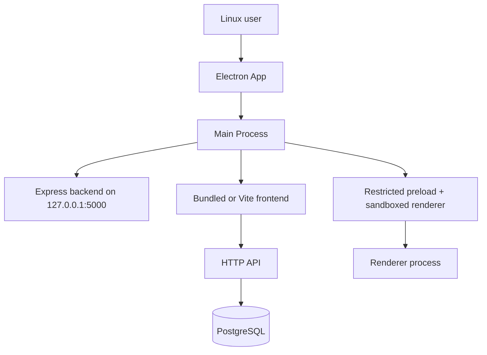

# Desktop architecture

## Goal

Create a Linux desktop wrapper around the existing HelpdeskPrime stack without rewriting the application. The desktop app keeps the current React frontend, Express backend, and PostgreSQL connection model, while adding an Electron shell and local lifecycle management.

## Current application model

The project is currently split into two runtime layers:

- Frontend: React + Vite
- Backend: Node.js + Express
- Database: PostgreSQL

The current app startup flow is:

- backend runs with `node server.js`
- frontend runs with `vite`
- database is connected through environment variables and PostgreSQL driver
- auth is based on cookies and JWT

The existing API remains the source of truth; the desktop app should not replace it.

## Electron architecture

The desktop application is structured as a thin desktop shell around the existing web stack.



### Processes

- Main process: app lifecycle, child-process management, window creation, shutdown logic
- Preload script: exposes a minimal API to the renderer
- Renderer process: loads the existing frontend UI

## Security model

The Electron app follows strict desktop security rules:

- `nodeIntegration: false`
- `contextIsolation: true`
- `sandbox: true`
- preload script exposes only a minimal API
- renderer cannot access Node.js directly
- backend binds to `127.0.0.1` in desktop mode
- no browser is opened; the app loads the local frontend directly

This preserves the existing app protections instead of disabling them.

## Backend lifecycle

The desktop app starts the backend as a child process before the UI is shown.

Behavior:

1. Electron starts the main process.
2. The main process loads environment values from `.env` or `.env.example` if present.
3. It starts the Express backend with `ELECTRON_APP=true` and `HOST=127.0.0.1`.
4. The app waits for `/api/health` to become available.
5. The UI is opened only after the backend is ready.
6. On quit, backend and frontend child processes are terminated gracefully.

This keeps the desktop shell close to the current web architecture while ensuring clean shutdown.

## Frontend loading

Two modes are supported:

### Development mode

- backend starts from `backend/server.js`
- frontend starts with Vite on `http://127.0.0.1:5173`
- the Electron window loads the local Vite URL

### Production mode

- frontend must be built with `npm --prefix frontend run build`
- the Electron window loads the built `frontend/dist/index.html`
- backend remains local and is started by the Electron main process

## PostgreSQL integration

The desktop app does not replace PostgreSQL with SQLite.

The current backend still uses the same PostgreSQL driver and environment variables:

- `DB_HOST`
- `DB_USER`
- `DB_PASSWORD`
- `DB_NAME`
- `DB_PORT`

This means PostgreSQL remains a system dependency. The desktop app starts the app locally, but it still relies on a reachable local or configured PostgreSQL instance. The project already documents environment separation in `.env.example` and the deployment runbook, and that pattern remains valid for desktop usage.

## Runtime commands

### Development

```bash
npm install
npm run desktop:dev
```

### Production build

```bash
npm --prefix frontend run build
npm run desktop:appimage
```

The build target is Linux AppImage.

## Files added

- `package.json`
- `electron/main.js`
- `electron/preload.js`
- `electron/electron-builder.config.js`
- `docs/DESKTOP_ARCHITECTURE.md`

## Files updated

- `backend/server.js`

## Security notes

- No direct Node access from the renderer
- No `0.0.0.0` binding in desktop mode
- backend host remains `127.0.0.1`
- no bypass of existing auth or API protections

## Known limitations

- This is a desktop shell around the current app; it does not rewrite the current pages or API.
- PostgreSQL remains external to the Electron app and must be available.
- The AppImage build requires a local frontend build before packaging.
- Desktop mode depends on the backend and current environment variables being valid.
- The app is designed for Linux; no Windows/macOS packaging was configured here.

## Operational checklist

Before desktop use, verify:

- PostgreSQL is reachable
- `.env` or the default environment is valid
- frontend can build successfully
- backend health endpoint responds on `http://127.0.0.1:5000/api/health`
- app closes cleanly and terminates child processes
